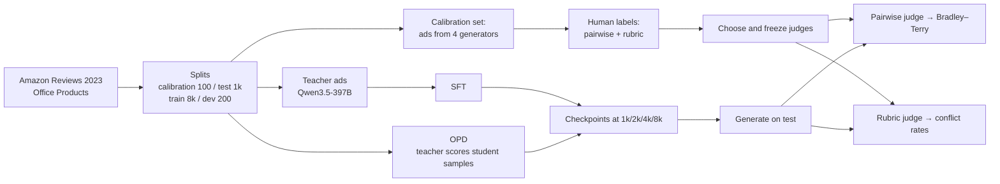

# AdGenius+

**English** | [简体中文](README.zh-CN.md)

AdGenius+ compares two ways of distilling a large teacher (Qwen3.5-397B) into a small student (Qwen3.5-0.8B) that writes short ads for Amazon Office Products listings:

- **SFT**: supervised fine-tuning on ads written by the teacher;
- **OPD**: on-policy distillation, where the student samples its own ads and the teacher scores them token by token.

Both are evaluated with LLM judges that were first calibrated against human labels: a pairwise judge for ad quality, summarized with a Bradley–Terry model, and a rubric judge for factual consistency with the product information.

📄 Paper (first draft): [docs/AdGenius_first_draft.pdf](docs/AdGenius_first_draft.pdf) · Full test report (Chinese): [docs/test_evaluation_v1.md](docs/test_evaluation_v1.md)

## Main results

1,000 held-out test products, ten systems (SFT and OPD checkpoints at 1k/2k/4k/8k training products, the untrained student, the teacher), 32,000 pairwise judgments and 10,000 rubric checks. All runs use **a single training seed**.

| Scale | OPD win rate vs SFT [95% CI] | Conflict rate OPD / SFT | Δ OPD − SFT, points [95% CI] |
|---|---|---|---|
| 1k | 0.486 [0.46, 0.51] | 7.7% / 11.4% | **−3.7** [−5.9, −1.5] |
| 2k | **0.467** [0.44, 0.49] | 7.9% / 10.9% | **−3.0** [−5.2, −0.8] |
| 4k | 0.493 [0.47, 0.52] | 7.5% / 9.2% | −1.7 [−3.7, +0.3] |
| 8k | **0.446** [0.42, 0.47] | 6.1% / 8.0% | −1.9 [−3.8, 0.0] |

Win rate counts both judge orders won as 1 and a split as 0.5. Intervals are product-level bootstrap intervals; the Δ intervals are computed exactly. Bold marks differences whose interval excludes no difference (0.5 or 0).

- **Quality favors SFT; faithfulness favors OPD.** Pairwise point estimates favor SFT at every scale, significantly at 2k and 8k. OPD has fewer judged contradictions with the product information at every scale, significantly at 1k and 2k and borderline at 8k.
- **Most of the gain comes from the first 1k products.** Against the untrained student, SFT 1k and OPD 1k win 0.88 and 0.87 of pairs, and the conflict rate drops from 17.9% to 7.7–11.4%. More data still helps, but less.
- **The teacher is still clearly ahead**: Bradley–Terry score 3.53 versus 2.80 (SFT 8k) and 2.61 (OPD 8k), conflict rate 2.8%.
- **Why the two judges disagree**: the pairwise judge sees only the two ads, not the product, so it cannot catch a claim that contradicts the product. Quality and faithfulness have to be measured separately.

Differences of 2–5 points could partly come from training randomness, which one seed cannot rule out. Limitations are discussed in the paper.

## Judges and their calibration

| Judge | Measures | Human agreement | Details |
|---|---|---|---|
| Pairwise (DeepSeek, both A/B orders) | Which of two ads is better | 83.5% on 100 calibration pairs | [docs/pairwise_llm_judge.md](docs/pairwise_llm_judge.md), [4-judge comparison](results/pairwise/comparison/report.md) |
| Rubric (DeepSeek) | Does the ad contradict the product information (`factual_support`) | accuracy 0.938, Cohen's κ 0.716 on 130 ads | [docs/rubric_llm_judge.md](docs/rubric_llm_judge.md), [agreement report](docs/rubric_judge_agreement.md), [rubric v0.2](docs/individual_rubric_v0.2.md) |

The Bradley–Terry comparison design was committed before any test judgment ([configs/eval/bt/test_sft_opd_v1.toml](configs/eval/bt/test_sft_opd_v1.toml), method in [docs/bradley_terry_eval.md](docs/bradley_terry_eval.md)).

## Pipeline



## Repository layout

```text
src/adgenius/   shared LLM client and product rendering (shared/), judges and statistics (eval/)
scripts/        data preparation, generation, judging, BT summaries; training in sft/, opd/, formal/
tools/          local web workbenches for human pairwise and rubric labels
configs/        model endpoints (models.toml), judge configs and BT designs (eval/)
prompts/        judge prompts
metadata/       JSON schemas for the shared record formats
data/           splits, products, calibration (gold) set, training data, test pairs
results/        per-item judge results, metrics and reports; training outputs and generations
docs/           methods, reports and the paper draft
tests/          offline tests
deprecated/     retired pilots and older data, kept for provenance
```

`artifacts/` (call logs, caches, checkpoints) and `.env` stay local and are not in Git. A data index is in [data/README.md](data/README.md) and a results index in [results/README.md](results/README.md).

## Quick start

Python 3.11+.

```bash
python -m venv .venv && .venv/bin/python -m pip install -e .
```

These checks need no API key and no network:

```bash
PYTHONPATH=src .venv/bin/python -m unittest discover -s tests
```

```bash
PYTHONPATH=src .venv/bin/python scripts/validate_gold_data.py
```

Recompute the test Bradley–Terry scores from the committed judge results (about 5 seconds):

```bash
PYTHONPATH=src .venv/bin/python scripts/summarize_bt.py --design configs/eval/bt/test_sft_opd_v1.toml --results results/pairwise/deepseek41_test_sft_opd_v1/results.jsonl --output-dir /tmp/bt_check
```

Recompute the test conflict rates and their intervals from the committed rubric results:

```bash
PYTHONPATH=src .venv/bin/python scripts/summarize_rubric.py --run-dir results/rubric/deepseek41_rubric_v1_test --generator-names base sft_1k sft_2k sft_4k sft_8k opd_1k opd_2k opd_4k opd_8k teacher_397b --output /tmp/rubric_check.json
```

`validate_gold_data.py` re-checks the calibration data, the human labels and the agreement statistics. All test generations, judge results and metrics are committed, so you can analyze them without calling any model.

## Calling models

Copy `.env.example` to `.env` and fill in the keys you need. Scripts load `.env` explicitly; endpoints are in [configs/models.toml](configs/models.toml).

| Alias | Provider / variable | Used for |
|---|---|---|
| `deepseek` | DeepSeek, `DEEPSEEK_API_KEY` | pairwise and rubric judge (default) |
| `qwen397b` | Alibaba Cloud Model Studio, `DASHSCOPE_API_KEY` | teacher ads |
| `qwen`, `claude`, `gpt6_luna` | DashScope, Anthropic, OpenAI | candidate judges in calibration |
| `gemma_31b`, `glm53_flash`, `longcat`, `qwen_local` | Google, Zhipu, LongCat, local Ollama | calibration ad generators |
| — | Tinker, `TINKER_API_KEY` | teacher log-probs during OPD |

```bash
PYTHONPATH=src .venv/bin/python scripts/llm_smoke.py --model deepseek
```

## Reproducing the experiments

| Step | Entry point | Docs |
|---|---|---|
| Data splits and products | `scripts/build_data_split.py`, `build_test_products.py`, `build_train_split.py` | [data_split.md](docs/data_split.md), [data_pipeline.md](docs/data_pipeline.md) |
| Calibration ads and pairs | `scripts/generate_candidates.py`, `build_candidate_pairs.py` | [gold_candidate_generation.md](docs/gold_candidate_generation.md) |
| Human labeling | `tools/pairwise_annotation.py`, `tools/rubric_annotation.py` | [tools/README.md](tools/README.md) |
| Judge calibration | `scripts/evaluate_pairwise.py`, `evaluate_rubric.py`, `compare_rubric.py` | [pairwise_llm_judge.md](docs/pairwise_llm_judge.md), [rubric_llm_judge.md](docs/rubric_llm_judge.md) |
| Teacher data | `scripts/generate_teacher_data.py`, `generate_teacher_test.py` | [sft_opd_experiment_plan.md](docs/sft_opd_experiment_plan.md) |
| SFT / OPD training (Colab GPU) | `scripts/sft/`, `scripts/opd/`, `scripts/formal/` | [training_notes.md](docs/training_notes.md), [training report](results/training/formal_v1_report.md) |
| Test evaluation | `scripts/build_bt_pairs.py`, `evaluate_pairwise.py`, `summarize_bt.py`, `evaluate_rubric.py --candidates` | [bradley_terry_eval.md](docs/bradley_terry_eval.md), [test_evaluation_v1.md](docs/test_evaluation_v1.md) |

Most method documents are written in Chinese. Developer notes (file layout, Git boundary, input/output contract, calling the client from code) are in [docs/architecture.md](docs/architecture.md).

## Data and license

- Code: [MIT](LICENSE).
- Our human labels, judge results, metrics, reports and documents: [CC BY 4.0](LICENSE-DATA.md).
- Product information comes from the Office Products metadata of **Amazon Reviews 2023** (Hou et al., 2024, [arXiv:2403.03952](https://arxiv.org/abs/2403.03952)) and is not covered by our licenses; ads written by third-party models may also be subject to the providers' terms. See [LICENSE-DATA.md](LICENSE-DATA.md), which also has citation entries.

## Authors

Zhou Yang and Chengkai Fang · CS 289A, UC Berkeley, Fall 2026.
