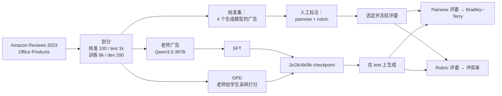

# AdGenius+

[English](README.md) | **简体中文**

AdGenius+ 比较两种把大老师模型（Qwen3.5-397B）蒸馏到小学生模型（Qwen3.5-0.8B）的方法，任务是为 Amazon Office Products 商品写简短广告：

- **SFT**：用老师写的广告做监督微调；
- **OPD**：在线策略蒸馏，学生自己采样广告，老师逐 token 打分。

两种方法都用先经人工标签校准过的 LLM 评委评测：pairwise 评委评广告质量，再用 Bradley–Terry 模型汇总；rubric 评委检查广告是否与商品资料矛盾。

📄 论文初稿：[docs/AdGenius_first_draft.pdf](docs/AdGenius_first_draft.pdf) · 完整 test 评测报告：[docs/test_evaluation_v1.md](docs/test_evaluation_v1.md)

## 主要结果

1,000 件留出的 test 商品，10 个系统（SFT 和 OPD 在 1k/2k/4k/8k 训练商品处的 checkpoint、未训练学生、老师），共 32,000 次 pairwise 判断、10,000 次 rubric 检查。所有训练**只用了一个种子**。

| 规模 | OPD 对 SFT 的胜率 [95% 区间] | 冲突率 OPD / SFT | 差值 OPD − SFT，百分点 [95% 区间] |
|---|---|---|---|
| 1k | 0.486 [0.46, 0.51] | 7.7% / 11.4% | **−3.7** [−5.9, −1.5] |
| 2k | **0.467** [0.44, 0.49] | 7.9% / 10.9% | **−3.0** [−5.2, −0.8] |
| 4k | 0.493 [0.47, 0.52] | 7.5% / 9.2% | −1.7 [−3.7, +0.3] |
| 8k | **0.446** [0.42, 0.47] | 6.1% / 8.0% | −1.9 [−3.8, 0.0] |

胜率的算法：两个顺序都赢记 1，各赢一次记 0.5。区间是按商品重抽样的 bootstrap 区间，冲突率差的区间是精确计算的。加粗表示区间不包含"没有差别"（胜率 0.5、差值 0）。

- **质量偏向 SFT，忠实度偏向 OPD。** 胜率的点估计在所有规模上都偏向 SFT，2k 和 8k 显著。OPD 在所有规模上与商品资料矛盾的广告都更少，1k 和 2k 显著，8k 在边界上。
- **大部分提升来自前 1k 个商品。** 对未训练学生，SFT 1k 和 OPD 1k 的胜率分别为 0.88 和 0.87，冲突率从 17.9% 降到 7.7%–11.4%。数据再多仍有提升，但越来越小。
- **老师仍明显领先**：Bradley–Terry 分数 3.53，SFT 8k 为 2.80，OPD 8k 为 2.61；老师冲突率 2.8%。
- **两个评委为什么方向相反**：pairwise 评委只看两条广告、不看商品资料，发现不了与商品矛盾的说法。所以质量和忠实度要分开测。

2–5 个百分点的差距可能部分来自训练随机性，一个种子无法排除。局限性见论文。

## 评委与校准

| 评委 | 测什么 | 与人工的一致程度 | 说明 |
|---|---|---|---|
| Pairwise（DeepSeek，A/B 两个顺序） | 两条广告哪条更好 | 100 对校准样本上一致率 83.5% | [pairwise_llm_judge.md](docs/pairwise_llm_judge.md)、[四评委对比](results/pairwise/comparison/report.md) |
| Rubric（DeepSeek） | 广告是否与商品资料矛盾（`factual_support`） | 130 条广告上准确率 0.938，Cohen's κ 0.716 | [rubric_llm_judge.md](docs/rubric_llm_judge.md)、[一致率报告](docs/rubric_judge_agreement.md)、[rubric v0.2](docs/individual_rubric_v0.2.md) |

Bradley–Terry 的比较设计在任何 test 评委判断之前提交（[configs/eval/bt/test_sft_opd_v1.toml](configs/eval/bt/test_sft_opd_v1.toml)，方法见 [docs/bradley_terry_eval.md](docs/bradley_terry_eval.md)）。

## 流程



## 仓库结构

```text
src/adgenius/   共享 LLM 客户端和商品渲染（shared/），评委和统计（eval/）
scripts/        数据准备、生成、评委、BT 汇总；训练在 sft/、opd/、formal/
tools/          本地网页标注台，用于人工 pairwise 和 rubric 标注
configs/        模型端点（models.toml）、评委配置和 BT 设计（eval/）
prompts/        评委 prompt
metadata/       共享记录格式的 JSON schema
data/           划分、商品、校准（gold）集、训练数据、test 比较对
results/        逐条评委结果、统计和报告；训练输出和生成结果
docs/           方法、报告和论文初稿
tests/          离线测试
deprecated/     退役的试跑和旧数据，保留来源记录
```

`artifacts/`（调用日志、缓存、checkpoint）和 `.env` 只在本地，不进 Git。数据索引见 [data/README.md](data/README.md)，结果索引见 [results/README.md](results/README.md)。

## 快速开始

需要 Python 3.11+。

```bash
python -m venv .venv && .venv/bin/python -m pip install -e .
```

下面的检查不需要 API Key，也不联网：

```bash
PYTHONPATH=src .venv/bin/python -m unittest discover -s tests
```

```bash
PYTHONPATH=src .venv/bin/python scripts/validate_gold_data.py
```

用已提交的评委结果重算 test 上的 Bradley–Terry 分数（约 5 秒）：

```bash
PYTHONPATH=src .venv/bin/python scripts/summarize_bt.py --design configs/eval/bt/test_sft_opd_v1.toml --results results/pairwise/deepseek41_test_sft_opd_v1/results.jsonl --output-dir /tmp/bt_check
```

用已提交的 rubric 结果重算 test 上的冲突率和区间：

```bash
PYTHONPATH=src .venv/bin/python scripts/summarize_rubric.py --run-dir results/rubric/deepseek41_rubric_v1_test --generator-names base sft_1k sft_2k sft_4k sft_8k opd_1k opd_2k opd_4k opd_8k teacher_397b --output /tmp/rubric_check.json
```

`validate_gold_data.py` 会重新核对校准数据、人工标签和一致率统计。test 上的所有生成结果、评委结果和统计都已提交，不调用任何模型也能分析。

## 调用模型

把 `.env.example` 复制为 `.env`，填入需要的 Key。脚本会显式加载 `.env`；端点配置见 [configs/models.toml](configs/models.toml)。

| 别名 | 平台 / 环境变量 | 用途 |
|---|---|---|
| `deepseek` | DeepSeek，`DEEPSEEK_API_KEY` | pairwise 和 rubric 评委（默认） |
| `qwen397b` | 阿里云百炼，`DASHSCOPE_API_KEY` | 老师广告 |
| `qwen`、`claude`、`gpt6_luna` | 百炼、Anthropic、OpenAI | 校准阶段的候选评委 |
| `gemma_31b`、`glm53_flash`、`longcat`、`qwen_local` | Google、智谱、LongCat、本地 Ollama | 校准集的广告生成模型 |
| — | Tinker，`TINKER_API_KEY` | OPD 训练时老师的 log-prob |

```bash
PYTHONPATH=src .venv/bin/python scripts/llm_smoke.py --model deepseek
```

## 复现实验

| 步骤 | 入口 | 文档 |
|---|---|---|
| 数据划分和商品 | `scripts/build_data_split.py`、`build_test_products.py`、`build_train_split.py` | [data_split.md](docs/data_split.md)、[data_pipeline.md](docs/data_pipeline.md) |
| 校准集广告和比较对 | `scripts/generate_candidates.py`、`build_candidate_pairs.py` | [gold_candidate_generation.md](docs/gold_candidate_generation.md) |
| 人工标注 | `tools/pairwise_annotation.py`、`tools/rubric_annotation.py` | [tools/README.md](tools/README.md) |
| 评委校准 | `scripts/evaluate_pairwise.py`、`evaluate_rubric.py`、`compare_rubric.py` | [pairwise_llm_judge.md](docs/pairwise_llm_judge.md)、[rubric_llm_judge.md](docs/rubric_llm_judge.md) |
| 老师数据 | `scripts/generate_teacher_data.py`、`generate_teacher_test.py` | [sft_opd_experiment_plan.md](docs/sft_opd_experiment_plan.md) |
| SFT / OPD 训练（Colab GPU） | `scripts/sft/`、`scripts/opd/`、`scripts/formal/` | [training_notes.md](docs/training_notes.md)、[训练报告](results/training/formal_v1_report.md) |
| Test 评测 | `scripts/build_bt_pairs.py`、`evaluate_pairwise.py`、`summarize_bt.py`、`evaluate_rubric.py --candidates` | [bradley_terry_eval.md](docs/bradley_terry_eval.md)、[test_evaluation_v1.md](docs/test_evaluation_v1.md) |

开发说明（文件布局、Git 边界、输入输出约定、在代码中调用客户端）见 [docs/architecture.md](docs/architecture.md)。

## 数据与许可证

- 代码：[MIT](LICENSE)。
- 我们的人工标签、评委结果、统计、报告和文档：[CC BY 4.0](LICENSE-DATA.md)。
- 商品资料来自 **Amazon Reviews 2023** 的 Office Products 元数据（Hou et al., 2024，[arXiv:2403.03952](https://arxiv.org/abs/2403.03952)），不在我们的许可证范围内；第三方模型写的广告也可能受各平台条款约束。详见 [LICENSE-DATA.md](LICENSE-DATA.md)，其中也有引用格式。

## 作者

Zhou Yang、Chengkai Fang · CS 289A，UC Berkeley，2026 年秋季。
