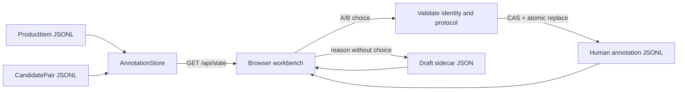

# Pairwise Human Annotation Workbench

## Purpose

The local pairwise workbench creates a reproducible human preference dataset for calibrating the later LLM-as-judge pipeline. It presents one frozen `CandidatePair` at a time together with its `ProductItem`, hides model identity, records an independent human choice, and writes the result directly to a JSONL file.

The current completed batch is `gold_pairwise_v2`:

- 100 frozen Office Products items and 100 frozen candidate pairs.
- One pair per product, sampled from four generated candidates with seed `42`.
- 100 completed independent annotations by `zhou`.
- Forced A/B preference: the interface has no tie option.
- `protocol_version=pairwise-v0.1`.

The labels are calibration data for evaluator agreement and are not training data. They should not be described as a two-person consensus set until a second annotator has independently labeled the same pairs and disagreements have been resolved separately.

## Design Principles

### Local files as the source of truth

The workbench reads the frozen product and pair JSONL files and persists annotations directly beside them. This keeps labels easy to inspect, version in Git, and reuse in evaluator calibration. Browser refreshes and server restarts recover saved progress from those files. No model API is called during annotation.

### Stable candidate identity, randomized presentation

The frozen `CandidatePair` stores two candidates in canonical array order. This order is not a judgment and does not define the visible A/B positions.

Each time a pair is entered, the browser independently randomizes which candidate appears on the left and right. The current `presentation` mapping records the visible positions:

```json
{"A": "cand_demo_1", "B": "cand_demo_2"}
```

When an existing annotation is reopened, the saved `winner_candidate_id` is mapped back to the current visible side. This prevents a new random arrangement from changing the displayed selection or from writing a new label merely because the user browsed to the pair.

### Forced relative preference

The annotator must choose the relatively better ad, either A or B. There is no tie button or tie keyboard shortcut. If both ads are weak, the annotator still selects the better of the two. If the annotator needs to investigate a pair, the reason can be saved as a draft without submitting a conclusion.

The judgment considers factual support, specific information that helps a shopper understand the product, and clear, natural, concise expression. Covering every feature or mentioning more facts does not automatically make an ad better. Product information is rendered with the same field-selection function used for generation.

The backend accepts only new A/B annotations. The reader remains tolerant of historical tie records so that an older dataset cannot become unreadable after the protocol change; those records are not created by the current interface.

### Independent judgment

The page does not show the source model, model tier, generation run, another annotator's label, or an LLM judge result. Both ads use the same layout. Human comparison is later aligned by `pair_id` and `winner_candidate_id`, never by the visible A/B letter.

## End-to-End Flow



1. `AnnotationStore` reads and validates the product and pair files on every state request.
2. The browser renders the current product, two candidate texts, progress, and the pair directory.
3. An A/B choice sends the visible presentation mapping, choice, reason, dataset revision, and expected prior annotation.
4. The server validates the pair membership, candidate mapping, A/B-only choice, and compare-and-swap value before writing.
5. A successful choice is written to the annotator's JSONL file, the draft for that pair is removed, and the UI opens the next unlabeled pair.
6. A reason entered without a choice is written to a separate draft sidecar and does not count as a completed label.
7. The browser polls state once per second so edits made by another page or process become visible without restarting the server.

## File Layout

The current batch is kept together so the frozen inputs and labels can be reviewed or reproduced as one unit:

```text
data/eval/gold/
├── product_items.jsonl
├── candidate_pairs.jsonl
├── candidate_pairs.manifest.json
├── pairwise_annotations_zhou.jsonl
└── pairwise_drafts_<annotator_id>.json   # optional runtime draft sidecar
```

`candidate_pairs.manifest.json` records the seed, source generation hashes, product hash, candidate-pair hash, model aliases, and sampling combination counts. It is provenance for the frozen pair set and is not shown to annotators.

Each completed annotation follows the human variant of [PairwiseResult](../metadata/schemas/pairwise_result.schema.json):

```json
{
  "annotation_id": "human_pw_demo_1",
  "judge_type": "human",
  "annotation_set_id": "gold_pairwise_v2",
  "pair_id": "pair_demo_1",
  "annotator_id": "zhou",
  "protocol_version": "pairwise-v0.1",
  "presentation": {"A": "cand_demo_1", "B": "cand_demo_2"},
  "pairwise_result": {
    "status": "success",
    "choice": "A",
    "winner_candidate_id": "cand_demo_1",
    "reason": null,
    "error": null
  }
}
```

The dataset-level checks require complete unique pair coverage, exactly the two candidates from the referenced pair in `presentation`, and a winner ID consistent with the selected side. The current file has 100 successful records, no duplicate or missing pairs, no tie choices, and no unfinished drafts.

## Browser Behavior

The workbench uses the project's Python environment and needs no frontend build step or additional frontend dependencies. It serves the HTML, CSS, and JavaScript from `tools/pairwise_annotation/` and uses the browser's `fetch` API for synchronization.

- A/B buttons save immediately after a successful choice.
- After the save completes, the page advances to the next unlabeled pair, skipping completed pairs and wrapping around to earlier gaps.
- A failed save or a conflict leaves the current pair visible. A reason-only draft also leaves the current pair visible.
- Editing the reason of an already labeled pair updates the existing label without automatic navigation.
- Reasons are optional. To attach one before automatic navigation, enter it before choosing A/B; a saved annotation can also be reopened to add or edit its reason.
- Previous, next, next-unlabeled, and directory navigation all flush pending changes before changing pairs.
- The directory distinguishes labeled, unlabeled, drafted, and current pairs.
- A/B keyboard shortcuts select a side; arrow keys navigate.
- The English interface keeps product and candidate text in their original English form while allowing the reason to be written in any language.

## Persistence and Concurrency

The server protects local files using several independent safeguards:

- Per-annotator file locks serialize writes from multiple pages.
- `dataset_revision` rejects writes made against changed product or pair files.
- `expected_annotation` and `expected_draft` provide compare-and-swap protection for the active record.
- JSONL and draft writes use a temporary file, `fsync`, and atomic replacement.
- Malformed input or annotation files are rejected before any write is attempted.
- Responses use `Cache-Control: no-store` so polling observes current local state.
- Each annotator has an independent annotation and draft path.

The UI also guards against stale polling responses, in-flight saves, annotator switches, and edits made while a request is pending. A stale response cannot overwrite a newly saved label in the browser state.

## Local Usage

From the repository root, run the v2 batch with:

```sh
.venv/bin/python tools/pairwise_annotation.py \
  --pairs data/eval/gold/candidate_pairs.jsonl \
  --products data/eval/gold/product_items.jsonl \
  --annotations-dir data/eval/gold \
  --annotator zhou \
  --annotation-set-id gold_pairwise_v2 \
  --protocol-version pairwise-v0.1
```

Open `http://127.0.0.1:8765/?annotator_id=zhou`. Use a different annotator ID for an independent label file. The server is intended for local annotation on a trusted machine; it does not provide authentication, TLS, or multi-user network access.

## Validation

The workbench has focused offline tests for:

- disk-backed A/B annotation and reload;
- randomized presentation with stable winner identity;
- no-tie enforcement and clear behavior;
- drafts, retries, conflicts, and concurrent writes;
- stale polling and annotator switching;
- automatic advance after successful saves;
- final-pair completion behavior.

The completed v2 inputs and labels pass the ProductItem, CandidatePair, and human PairwiseResult JSON Schemas, plus dataset-level coverage and winner-mapping checks. These checks validate the annotation artifact before it is used to calibrate an LLM judge.

## Current dataset organization

The complete 400 generated candidates are now shared alongside the frozen pairs in data/eval/gold. The current Zhou labels contain 15 user-confirmed model-assisted revisions; original labels and revision records are archived under deprecated. Record IDs, annotation-set ID gold_pairwise_v2, and protocol pairwise-v0.1 were retained. Full generation/judge call journals stay in artifacts. See [data/README.md](../data/README.md).
