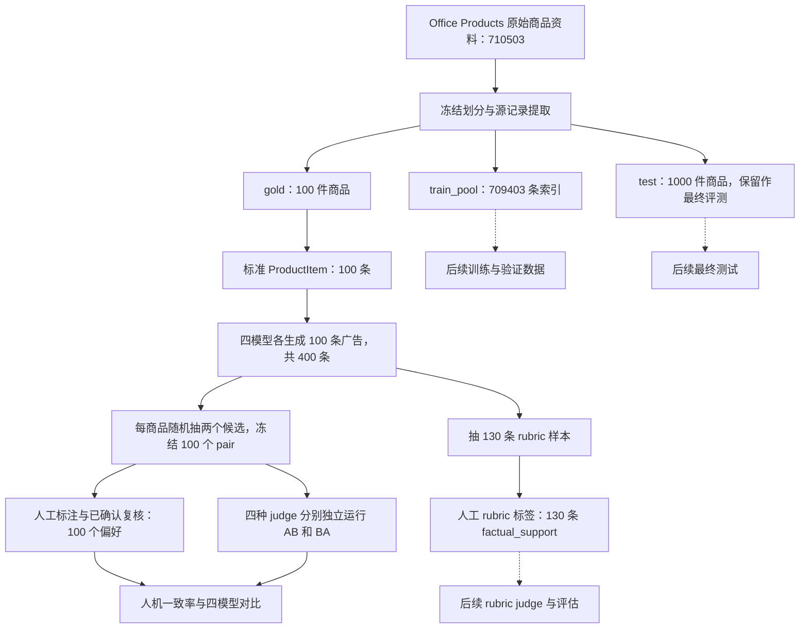

# 数据说明与生产链路

本文是当前实验数据的统一入口，记录每类数据是什么、从哪里来、如何生产、由谁消费，以及目前能够重建到哪一步。路径均相对于仓库根目录；状态截至 **2026-11-14**。精确内容、数量、模型参数和 SHA-256 以对应 manifest 为准。

## 1. 数据边界与依赖关系

| 目录 | 保存内容 | Git 约定 |
|---|---|---|
| `data/` | 后续实验复用的正式数据，包括冻结的生成候选和当前人工标签 | 共享 |
| `results/` | 正式逐条评测结果、派生结论、汇总指标和报告 | 共享 |
| `artifacts/` | 生成运行快照、完整调用日志、缓存、临时产物和未来模型权重 | 整体忽略 |
| `deprecated/` | 已废弃的数据、原始人工标签、复核记录、试跑和旧文档 | 原始标签、复核记录及大型旧产物仅本地保存；其他归档见[归档说明](../deprecated/README.md) |

同样是模型输出，400 条候选在确认后成为后续标注的输入，因此发布在 `data/`；judge 的判断作为实验结果放在 `results/`。`artifacts/` 中保留原始运行快照和调用过程。发布到 `data/` 不是脚本自动完成的步骤。



虚线部分尚未落地。**gold 与 test 是两个互不重叠的商品集合；两者都排除在训练池之外。** gold 用于评委校准，最终 test 不参与 prompt 调整或评委选择。当前没有标准化 test ProductItem、测试广告、rubric 模型评分或 SFT 数据；rubric 目前只有人工标签（见第 9 节）。

## 2. 当前文件清单

### 正式输入数据

| 文件 | 一条记录代表什么 | 数量 / 用途 | 生产来源 |
|---|---|---|---|
| `data/splits/v1/gold.jsonl` | 一件商品的 gold 归属和原始行号 | 100；冻结校准边界 | 原始资料 → `build_data_split.py` |
| `data/splits/v1/test.jsonl` | 一件商品的 test 归属和原始行号 | 1,000；冻结最终测试边界 | 同上 |
| `data/splits/v1/manifest.json` | 一次源数据划分的说明 | 源文件哈希、种子、分组、数量、输出哈希和训练池路径 | 划分脚本；后续目录调整保留溯源说明 |
| `data/processed/v1/gold_products.jsonl` | 原始格式商品对象 | 100；保留原始 gold 资料 | 划分时按源文件顺序提取 |
| `data/processed/v1/test_products.jsonl` | 原始格式商品对象 | 1,000；保留原始 test 资料 | 同上 |
| `data/eval/gold/product_items.jsonl` | 标准 `ProductItem` | 100；生成和商品信息展示共用 | 原始 gold 商品包装，见第 4 节 |
| `data/eval/gold/results_qwen_local.jsonl` | 一次候选生成的最终标准结果 | 100；本地 Qwen 候选 | 生成、失败补跑后发布 |
| `data/eval/gold/results_gemma_31b.jsonl` | 同上 | 100；Gemma 候选 | 同上 |
| `data/eval/gold/results_glm53_flash.jsonl` | 同上 | 100；GLM 候选 | 同上 |
| `data/eval/gold/results_longcat.jsonl` | 同上 | 100；LongCat 候选 | 同上 |
| `data/eval/gold/candidate_pairs.jsonl` | 同商品的两个候选及文本快照 | 100；人工和模型比较相同对象 | 四份候选 → `build_candidate_pairs.py` |
| `data/eval/gold/candidate_pairs.manifest.json` | 一次 pair 抽样说明 | 输入哈希、seed、组合分布、输出哈希 | pair 构建脚本；当前路径已整理 |
| `data/eval/gold/pairwise_annotations_zhou.jsonl` | 一位标注者对一个 pair 的偏好 | 100；当前人工参照 | 标注台 + 15 条已确认的复核修改 |
| `data/eval/gold/rubric_sample.jsonl` | rubric 标注用的一条候选及其生成模型 | 130；冻结样本 | 四份候选 → `build_rubric_sample.py` |
| `data/eval/gold/rubric_sample.manifest.json` | 一次 rubric 抽样说明 | 输入哈希、seed、模型分布、输出哈希 | 同上 |
| `data/eval/gold/rubric_annotations_zhou.jsonl` | 一位标注者对一条候选的 rubric 判断 | 130；当前 rubric 人工参照，17 条 False | zhou 定稿，规则见 [rubric v0.2](individual_rubric_v0.2.md) |
| `data/eval/gold/manifest.json` | 当前 gold 数据集说明 | 文件哈希、数量、schema、生成 prompt/模型/参数和标签版本 | 发布、整理时维护的冻结索引 |

JSONL 文件均为每行一个 JSON 对象。`splits/v1` 和 `processed/v1` 的 `v1` 表示仍在使用的源划分，不表示存在多套并行使用的候选数据。当前正式 gold 只有 `data/eval/gold/` 这一套。

### 正式评测结果

以下四个目录分别保存一次 judge 全量运行：

- `results/pairwise/qwen37_gold_v2/`
- `results/pairwise/deepseek41_gold_v2/`
- `results/pairwise/claude55_gold_v2/`
- `results/pairwise/gpt6_luna_gold_v2/`

| 每个目录中的文件 | 内容与粒度 | 数量 |
|---|---|---|
| `results.jsonl` | 一个 pair 的标准 `PairwiseResult`，内含 AB、BA 两次独立判断、理由和 trace | 每个 judge 100 条，共 400 条记录 / 800 次最终有效判断 |
| `decisions.jsonl` | 同一 pair 两个顺序的合并状态与赢家 ID | 每个 judge 100 条 |
| `manifest.json` | 原始运行时捕获的模型、配置、输入、prompt、代码指纹等 | 每个 judge 一份 |

目录名中的 `v2` 是原始运行 ID 的一部分，整理目录时保留身份。原始运行 manifest 中的旧路径及旧人工标签哈希也是历史记录；当前文件位置和复核版标签引用见对比 manifest，不能改写原 manifest 来绕过续跑校验。

| 对比文件 | 用途 |
|---|---|
| `results/pairwise/comparison/metrics.json` | 四模型当前标签下的统计、模型间差值和商品级 bootstrap 区间 |
| `results/pairwise/comparison/report.md` | 对比结果和解释限制的可读报告 |
| `results/pairwise/comparison/manifest.json` | 当前数据集、人工标签、四份模型结果的位置和哈希，以及统计文件哈希 |

当前四个历史运行目录没有单独的复核版 `metrics.json`；**统一对比目录是当前统计入口**。今后新运行会在自己的结果目录生成 `metrics.json`。

### 本地来源、日志与归档

| 路径 | 内容 / 用途 |
|---|---|
| `../data/raw/amazon_reviews_2023/meta_categories/meta_Office_Products.jsonl.gz` | 仓库外的原始商品 metadata，710,503 条；不是用户评论正文 |
| `artifacts/cache/office_products/train_pool.jsonl` | 709,403 条训练候选池索引，约 208 MiB；没有广告或 SFT target |
| `artifacts/generation/gold/results_<alias>.jsonl` | 当前生成批次的本地最终快照；发布后的共享输入以 `data/eval/gold/` 为准 |
| `artifacts/generation/gold/calls_<alias>.jsonl` | 各模型所有生成尝试的请求、响应、失败、重试关系和 usage |
| `artifacts/pairwise/<run_id>/calls.jsonl` | judge 的调用日志；包括中途失败和补跑，行数可能大于 200 |
| `artifacts/annotation/workbench.log` | 标注服务运行日志；人工结论写在正式标签 JSONL 中 |
| `deprecated/data/eval/gold/pairwise_annotations_zhou.original.jsonl` | 复核前的人工标签，按约定退出当前数据路径 |
| `deprecated/artifacts/eval/gold_review/` | 四轮复核的修改记录和修改前快照 |
| `deprecated/migration_manifest.json` | 第一轮整理的路径迁移和哈希索引 |
| `deprecated/layout_migrations/data_results_artifacts_20261114/` | 后续目录调整前的元数据、迁移索引及静态校验记录 |

其他旧候选、旧 prompt、试跑和旧统计见[归档目录说明](../deprecated/README.md)。锁文件和草稿侧文件属于运行辅助文件，不是完成的偏好标签。`data/train/` 当前没有正式训练集；模型权重也尚未产出。

## 3. 原始资料 → 固定划分

生产入口：[scripts/build_data_split.py](../scripts/build_data_split.py)。详细背景见[划分说明](data_split.md)。

1. 读取原始 gzip JSONL，检查 `parent_asin` 非空且唯一；有无效记录时拒绝生产。
2. 对以下字段的规范 JSON 计算内容哈希分组，排除 `parent_asin`：`main_category`、`title`、`average_rating`、`rating_number`、`features`、`description`、`price`、`store`、`categories`、`details`。
3. 使用 seed **20261028** 对内容组做确定性哈希排序；先选足 100 条 gold，再从其余组中选足 1,000 条 test，不拆内容组，其余进入 train_pool。
4. 按原始文件顺序写出归属索引，额外保存 gold/test 的完整原始商品对象，并记录源文件与输出哈希。

这里保证上述字段完全相同的记录不会跨 split；不等价于语义去重、品牌隔离或完整商品家族隔离。这组划分字段还包含价格和评分，与后面实际发送给模型的字段选择不是同一套规则。

划分文件的 `source_line` 是原始解压 JSONL 中 **从 1 开始**的行号，`source_sha256` 绑定原始 gzip。训练池是候选边界，不代表会把全部 709,403 条用于训练。后续训练和 validation 都应从该池选择。

划分脚本会写固定的 `data/splits/v1/`、`data/processed/v1/` 和缓存路径，**不提供拒绝覆盖保护**。如需检查重建，应指定一个全新的隔离根目录，再与冻结文件核对，而不是直接覆盖当前仓库：

```sh
# 在尚不存在的新根目录中重建，不覆盖正式数据。
PYTHONPATH=src .venv/bin/python scripts/build_data_split.py \
  --source ../data/raw/amazon_reviews_2023/meta_categories/meta_Office_Products.jsonl.gz \
  --seed 20261028 \
  --repo-root /tmp/adgenius_split_rebuild_new
```

训练池已有项目 ID 的表示曾与历史 manifest 记录的 ASIN-only 表示不同。当前 manifest 已保存实际缓存哈希和 `cache_provenance`；恢复旧表示可复现历史哈希。目录整理没有改动缓存内容，详情在上述迁移记录中。

## 4. 原始 gold 商品 → ProductItem

输入是 `data/processed/v1/gold_products.jsonl`，输出是 `data/eval/gold/product_items.jsonl`。当前 100 条文件已存在，转换规则已按现存记录逐条核对：

```text
按 gold_products.jsonl 的现有行顺序，从 i = 0 编号：
product_id   = "gold_product_" + 六位补零的 i
source_id    = 原始 parent_asin
product_info = 原始商品对象去掉 parent_asin 后的全部字段
```

例如首条项目 ID 为 `gold_product_000000`。存储保留 `title`、`features`、`description`、`details`、`categories`、`main_category`、`store`、`price`、`average_rating`、`rating_number`、`images`、`videos`、`bought_together` 等原始属性；空值不在此步骤补造。

结构定义见 [product_item.schema.json](../metadata/schemas/product_item.schema.json)。**目前没有独立的 ProductItem 转换 CLI**，`build_data_split.py` 只输出原始格式商品，不能把它描述为已完成此转换。后续应补可复现的转换入口；在此之前直接消费已冻结的文件，不重新编号。test 的同类转换尚未执行。

## 5. ProductItem → 四模型候选

生产入口：[scripts/generate_candidates.py](../scripts/generate_candidates.py)；调用适配在 [shared/llm.py](../src/adgenius/shared/llm.py)。

| 别名 | 本批次实际模型 | 调用来源 |
|---|---|---|
| `qwen_local` | `qwen3.5:2b` | 本地 Ollama |
| `gemma_31b` | `gemma-4-31b-it` | Google |
| `glm53_flash` | `glm-5.3-flash` | BigModel |
| `longcat` | `LongCat-2.5` | LongCat |

每个商品由每个模型生成一条，`sample_index=0`，共 **4 × 100 = 400** 条。名称是此次冻结记录中的模型标识；历史实验以 gold manifest / 原始调用快照为准，不能只根据以后可能变化的 `models.toml` 推断历史配置。

输入由 [shared/product.py](../src/adgenius/shared/product.py) 渲染为文本章节：商品名、类别、features、description 和筛选后的 details。不会把 ProductItem JSON 整体发给模型；不发送顶层价格、评分、图片、视频等。details 还排除了厂家、型号、厂家零件号、排名、上架日期和停产状态等键。保存所有原始属性与只发送适合生成的属性是两个不同步骤。

生成 system prompt 位于脚本的 `SYSTEM_PROMPT`，本批次全文及哈希也冻结在 gold manifest。要求英文短广告、选择重要且适合短广告的信息，无需覆盖全部属性；一至两句，prefer <25 words、最多 35 words，并保持事实有依据。该长度是 prompt 约束，脚本没有按词数截断或进行广告质量筛选。

本批次 temperature=0.2、max_output_tokens=2048；各模型 thinking 等差异见 gold manifest。一个候选使用 `run_id + product_id + sample_index` 派生稳定 `candidate_id`。每次 API 尝试单独记录 `trace_id`，标准 [GenerationResult](../metadata/schemas/generation_result.schema.json) 只保存最终 `success/failed`、文本和字符串错误码。

失败修复入口是 [scripts/retry_failed_candidates.py](../scripts/retry_failed_candidates.py)：从调用日志恢复实际请求设置，只补失败候选，保持候选 ID 及成功样本不变。有限自动重试不保证每次都尝试四次；例如截断或无效返回可以直接记为失败，后续再显式补跑。**日志里存在 failed 不代表当前最终结果仍失败**；当前正式四份结果均为 100 条 success，success 仅表示生成过程成功，不表示广告通过质量评审。

新实验示例见[生成与补跑指南](gold_candidate_generation.md)。生成默认写入 `artifacts/generation/gold/`，并拒绝已有结果/日志文件；新批次指定新的输出目录。成功运行、补跑与将结果发布到 `data/` 是分开的步骤。

## 6. 400 条候选 → 100 个固定 pair

生产入口：[scripts/build_candidate_pairs.py](../scripts/build_candidate_pairs.py)。输入四份正式候选和 ProductItem，输出 [CandidatePair](../metadata/schemas/candidate_pair.schema.json) 及抽样 manifest。

- 先检查每个商品有四个模型各一条成功候选、`sample_index=0`，候选 ID 唯一且覆盖商品全集。
- 使用 seed **42**，为每个 `product_id` 根据规范 `[seed, product_id]` 的 SHA-256 构造独立 RNG，均匀抽两个不同模型。
- 每商品一个 pair。候选数组按 `candidate_id` 排序；pair ID 由 seed、商品及候选快照派生。输入重排不改变抽样结果。
- 一共 100 对、引用 200 个候选；其余 200 个候选仍留在正式数据中。rubric 样本从全部 400 条中另行抽取，与 pair 是否入选无关（见第 9 节）。

| 模型组合 | pair 数 |
|---|---:|
| Gemma + GLM | 21 |
| Gemma + LongCat | 16 |
| Gemma + Qwen | 16 |
| GLM + LongCat | 9 |
| GLM + Qwen | 27 |
| LongCat + Qwen | 11 |

这是随机抽样后冻结的分布，没有强行使六种组合数量相等。构建脚本要求显式 `--output`，拒绝覆盖已有输出；离线重建示例见[生成指南](gold_candidate_generation.md)。pair 的文本是来源候选的冻结快照，不能单独手改。

## 7. 固定 pair → 当前人工标签

生产入口：[tools/pairwise_annotation.py](../tools/pairwise_annotation.py)。[标注台文档](pairwise_annotation_workbench.md)说明随机左右展示、即时 JSONL 同步、目录与翻页、保存后自动跳转和并发写入保护。

当前由 `zhou` 完成同一组 100 对的强制二选一，没有平局选项。人工 schema 使用 `judge_type="human"`，`annotation_set_id="gold_pairwise_v2"`、`protocol_version="pairwise-v0.1"`。商品资料可在人工界面查看；后面的文本评委不接收商品资料，二者输入条件不完全相同。

原始标注后，用户确认了 **15 条模型辅助复核修改**。Git 只提交最终 100 条人工标签；复核前文件及四轮记录仅在本地 `deprecated/` 保存，并由忽略规则排除。这是单人偏好参照，不能写作两人独立标注的一致共识，也不能把复核后的高一致率解释为新的盲测结果。

每条标签记录当时的 `presentation`、`choice` 和 `winner_candidate_id`。同一 pair 再次打开时左右可重新随机，显示结果按候选 ID 还原。**跨文件比较始终使用 `pair_id + winner_candidate_id`，不能直接比较人工与模型的字母 A/B。**

## 8. 固定 pair → judge 判断与对比统计

生产入口：[scripts/evaluate_pairwise.py](../scripts/evaluate_pairwise.py)，实现为 [eval/pairwise.py](../src/adgenius/eval/pairwise.py)；完整参数与续跑说明见 [judge 指南](pairwise_llm_judge.md)。

四种 judge 各对 100 个 pair 独立调用 AB、BA，共 200 个最终判断。使用 `pairwise-v0.2` 和 [system_v2.txt](../prompts/eval/pairwise/system_v2.txt)、[user_v2.txt](../prompts/eval/pairwise/user_v2.txt)：只根据两个广告文本判断信息流中的传播效果，不看原始商品、生成模型来源或人工标签。事实核查留给后续 rubric。两次调用不会互相读取判断结果。

返回的 Ad 1 / Ad 2 选择被归一化为固定 `candidate_mapping` 下的 A/B。模型 [PairwiseResult](../metadata/schemas/pairwise_result.schema.json) 一条必须包含 AB、BA 两项。派生 `decisions.jsonl` 的规则在 [pairwise_metrics.py](../src/adgenius/eval/pairwise_metrics.py)：

| 状态 | 含义 |
|---|---|
| `stable` | 两次都成功且选择同一候选 |
| `order_inconsistent` | 两次成功但赢家不同；不是质量平局，不重试到一致为止 |
| `incomplete` | 至少一个方向缺失或失败 |

新运行将标准结果、decisions、metrics、manifest 写到 `results/pairwise/<run_id>/`，日志写到 `artifacts/pairwise/<run_id>/calls.jsonl`。未改变数据、配置、prompt、代码且保留日志时，重复同一运行可只补失败/缺失方向。改变上述条件应创建新 run ID，不能覆盖冻结记录。

当前统一统计由现有四份结果对齐复核版人工标签计算，**没有重跑模型**：

- AB / BA 一致率：各方向的有效判断与人工赢家 ID 比较，报告各自分母。
- 平均一致率：先在商品内平均 AB、BA 的匹配指示，再在商品间平均；当前四模型均完整，所以等于两个方向一致率的平均。
- 稳定子集一致率：只比较 `stable` pairs，必须同时报告数量和覆盖率，不能与全量一致率混用。
- 顺序一致率、首位选择率描述 judge 的行为；修改人工标签不会改变这些值。
- tokens、失败尝试和耗时使用调用日志统计，包括失败和补跑；未知 usage 不能记作零。
- 已发布 bootstrap 使用商品为单位，10,000 次、seed **20261113**，AB/BA 保持在同一重采样单元；模型间差值使用配对商品重采样。

单运行常规统计已有 `summarize` 函数；**当前四模型汇总、配对 bootstrap 与 report 是此前离线维护分析的产物，尚无专门的一键重建 CLI**。已有 JSON 与报告已冻结，不能把评测脚本误写成能自动重建整个 comparison 目录。bootstrap 也没有计入模型辅助复核引入的标注选择不确定性。

读取和校验共享结果不需要调用日志；重新统计完整历史 tokens/耗时、排查请求或续跑原运行则需要对应日志。标签若再次修改，当前 comparison 不会自动刷新，需要显式重新统计与更新 manifest。

## 9. 候选 → rubric 样本与人工标签

本节状态截至 **2026-11-23**。

**抽样。** 生产入口：[scripts/build_rubric_sample.py](../scripts/build_rubric_sample.py)。输入四份正式候选和 ProductItem，输出 `rubric_sample.jsonl` 及 manifest。

- 取 `qwen_local` 的全部 100 条候选。
- 使用 seed **20261123**，从排序后的商品 ID 中抽 30 个不同商品，Gemma、GLM、LongCat 各分 10 个，取该模型在该商品上的候选。
- 130 条打乱后编号为 `rubric_item_001` … `rubric_item_130`。每行记录 `item_id`、`candidate_id`、`product_id` 和 `generator`。

抽样脚本默认写入冻结路径且**不拒绝覆盖**，检查重建时应指定新的 `--output` 再与冻结文件核对。

**标注。** 生产入口：[tools/rubric_annotation.py](../tools/rubric_annotation.py)。[标注台文档](rubric_annotation_workbench.md)说明隐藏生成模型、商品资料渲染、即时 JSONL 同步和并发写入保护；判定规则见 [rubric v0.2](individual_rubric_v0.2.md)。

当前 `rubric_annotations_zhou.jsonl` 是 zhou 定稿的 130 条标签，只含 `factual_support`。人工 schema 使用 [RubricResult v1](../metadata/schemas/rubric_result.schema.json) 的 human 记录，`annotation_set_id="gold_rubric_v1"`、`protocol_version="rubric-v0.2"`。结果为 17 条 False，全部来自 qwen_local（100 条中 17 条）；其他三个模型的 30 条均为 True。每条 False 在理由中引用冲突的文案原文和资料原文。

这是单人标签，不能写作两人独立标注的一致共识。v0.2 中的边界裁定是在这 130 条上定下来的，用这批标签评估 judge 时需注意 prompt 是否直接写入了这些例子。

跨文件比较 rubric 结果时使用 `candidate_id`；`item_id` 只是样本内的展示编号。`scripts/validate_gold_data.py` 和 gold `manifest.json` 目前还不覆盖 rubric 样本与标签。

## 10. 字段与关联规则

五类共享结构定义在 [metadata/schemas/](../metadata/schemas/)，字段示例见 [metadata/README.md](../metadata/README.md)。数据用途由 split / dataset manifest 说明；ProductItem 不额外增加 human/model 字段。

| 字段 | 所属对象 / 关联规则 |
|---|---|
| 原始 `parent_asin` | 原始商品 ID；当前源文件中唯一 |
| `source_id` | ProductItem 和训练池索引保留的原始 ASIN |
| `product_id` | 标准 gold 使用 `gold_product_000000` 起的项目 ID；训练池使用 `train_product_000000` 起的项目 ID |
| split 索引中的 `product_id` | **gold/test 索引仍保存原始 ASIN**，应与标准 ProductItem 的 `source_id` 关联，不能直接按项目 `product_id` join |
| `candidate_id` | 一条具体生成候选；关联候选文件、pair 中的文本、人工/模型赢家、rubric 样本与标签 |
| `item_id` | rubric 样本中的展示编号 `rubric_item_NNN`；只在 `rubric_sample.jsonl` 内使用，rubric 标签按 `candidate_id` 关联 |
| 生成 `run_id` | 一次生成批次及模型设置；同商品不同模型的候选有不同运行身份 |
| `pair_id` | 一组固定候选；关联 pair、人工标签、各 judge 结果与 decisions |
| `trace_id` | 一次 API 尝试；关联本地 calls；补跑可更新 trace 而保持候选 ID |
| `judge_run_id` | 一次评委运行；关联正式结果目录、原始 manifest 和本地日志 |
| `protocol_version` | 判断协议版本；与目录名、源划分版本和标签批次是不同概念 |

典型回溯路径：judge 记录 → `pair_id` → pair 中 `candidate_id` → 生成结果及 `product_id` → ProductItem 的 `source_id` → 原始商品 / split 的 ASIN 和源行号。排查某次请求再通过 `trace_id` 查本地 calls。

## 11. 可重建程度、校验与维护

| 环节 | 当前能力 | 前提与限制 |
|---|---|---|
| 原始资料 → split / 原格式商品 / 训练池 | 有生产脚本，可确定性重建数据归属 | 需要匹配哈希的原始 gzip、相同 seed；在新根目录输出，元数据中的绝对路径会随位置变化 |
| 原格式 gold → ProductItem | 当前冻结文件 + 已核对转换规则 | 尚无专用 CLI；保留既有源顺序与 ID |
| ProductItem → 广告候选 | 有生成和失败补跑脚本 | 外部模型及采样不保证重调用得到逐字相同内容；精确复现应读取冻结候选 |
| 候选 → pair | 有确定性脚本 | 四份冻结候选、商品全集、seed 42；可离线复现 |
| pair → 人工偏好 | 有标注系统及当前标签 | 人工决定无法由脚本重建；当前标签已含确认复核 |
| pair → 模型判断 | 有评测、日志和续跑机制 | 重调用不保证同一选择或理由；冻结结果是此次实验记录 |
| 结果 → decisions / 常规一致率 | 有派生函数及离线校验 | 需要同一 pair 集与指定标签快照；完整资源统计另需日志 |
| 四模型 comparison / bootstrap / report | 有冻结结果和计算口径 | 尚无专门批量重建 CLI，不能声称已一键复现 |
| 候选 → rubric 样本 | 有确定性脚本 | 四份冻结候选、商品全集、seed 20261123；脚本默认覆盖冻结文件，重建时指定新 `--output` |
| rubric 样本 → 人工标签 | 有标注台及当前标签 | 人工决定无法由脚本重建；`validate_gold_data.py` 尚不校验 |
| rubric judge、训练集、训练、最终 test 生成 | 尚未完成 | rubric 只有人工标签，没有模型评分；其余需要后续实现与实验记录 |

离线校验入口为 [scripts/validate_gold_data.py](../scripts/validate_gold_data.py)：

```sh
PYTHONPATH=src .venv/bin/python scripts/validate_gold_data.py
```

它只读取共享数据：校验 gold 文件哈希与 JSON Schema、400 条候选的身份与覆盖、pair 抽样及来源文本、人工映射、四份 judge 结果与当前一致率。它不调用 API，不写入新实验结果，也不替代全量原始资料/训练池审计、日志资源统计或 bootstrap 重建。

维护新实验或数据快照时：

1. 保留源数据、商品、候选和 pair 的稳定身份；为新生成或评测使用新的运行目录和 run ID。
2. 将确认的可复用输入发布到 `data/`，正式判断和报告放 `results/`，完整过程放 `artifacts/`。
3. 更新对应 manifest 的输入来源、实际模型与 prompt、参数、schema / 协议版本、数量和哈希；人工复核要标明标签版本及评测的参照条件。
4. 上游改变时检查下游：候选改变会影响 pair 和所有标注/判断；人工赢家改变会影响一致率与 comparison，不会自动改变 judge 结果。
5. 同步本文及 data/results 索引；旧记录按约定归入 `deprecated/` 并保留迁移映射，不能让历史路径看起来像当前可直接续跑的配置。

目前生产逻辑最需要后续补齐的两项是 **ProductItem 转换脚本** 和 **四模型对比报告重建脚本**。
