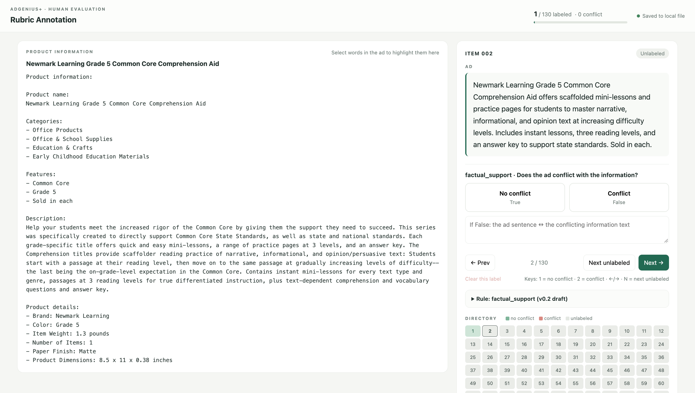
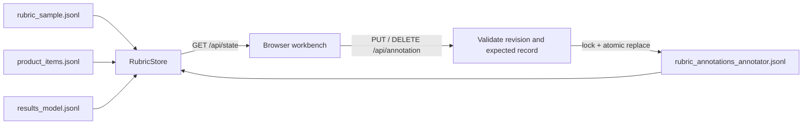

# Rubric Human Annotation Workbench

## Purpose

The local rubric workbench produces human labels for single ads, used to check how well a rubric LLM judge agrees with a human. It shows one frozen candidate ad at a time next to the product information it was generated from, hides which model wrote it, and writes each label directly to a JSONL file.

The labeling rule is [rubric v0.2](individual_rubric_v0.2.md). By default the page labels only `factual_support`: does the ad conflict with the product information?



The current batch is `gold_rubric_v1`:

- 130 frozen candidates from `data/eval/gold/rubric_sample.jsonl`.
- All 100 `qwen_local` candidates, plus 10 each from `gemma_31b`, `glm53_flash` and `longcat` on 30 distinct products.
- 130 labels by `zhou`, `protocol_version=rubric-v0.2`, criterion `factual_support` only.

The labels are calibration data for judge agreement, not training data. They come from one annotator and should not be described as a two-person consensus set.

## The Sample

[scripts/build_rubric_sample.py](../scripts/build_rubric_sample.py) builds the sample from the four frozen generation files and `product_items.jsonl`:

1. Take every `qwen_local` candidate (100).
2. With `random.Random(20261123)`, sample 30 distinct products from the sorted product IDs and assign 10 to each of the other three models; take that model's candidate for the product.
3. Shuffle all 130 rows and number them `rubric_item_001` … `rubric_item_130`.

Each row is `{"item_id", "candidate_id", "product_id", "generator"}`. `rubric_sample.manifest.json` records the input paths and SHA-256 hashes, the product file hash, the seed, item and generator counts, and the output hash.

The script writes to `data/eval/gold/rubric_sample.jsonl` by default and does not refuse to overwrite it. To check a rebuild, pass a new `--output` path and compare it with the frozen file.

## Design Principles

### Local files as the source of truth

The server reads the sample, the products and the generation files on every state request and writes labels beside them. Refreshing the page or restarting the server recovers saved progress from the file. No model API is called during annotation.

### Hidden generator

The sample row contains `generator`, but the server uses it only to find the ad text and never sends it to the page. The page shows the item number, the ad and the product information; candidate and product IDs are used only to save the label.

### Same product information as generation

The product information on the left is rendered with `_product_prompt` from [scripts/generate_candidates.py](../scripts/generate_candidates.py), the same text the generating model received. The annotator judges against exactly what the model was given.

### One record per ad

Every saved label is a complete record for one candidate. With several criteria (`--criteria factual_support concrete_product_info`), a label is saved only after every criterion has a value.

## End-to-End Flow



1. `RubricStore` checks that every sample row matches a generated candidate and its product, then builds the items without the generator.
2. The browser loads the state once and opens the first unlabeled item, or the item in the URL hash (`#rubric_item_042`).
3. A choice sends the values, reasons, `dataset_revision` and the expected prior record.
4. The server validates them and rewrites the annotator's file in sample order.

## File Layout

```text
data/eval/gold/
├── product_items.jsonl
├── results_<model>.jsonl
├── rubric_sample.jsonl
├── rubric_sample.manifest.json
├── rubric_annotations_zhou.jsonl
└── .rubric_<annotator>.lock          # runtime lock file, ignored by Git
```

Each label follows the human variant of [RubricResult v1](../metadata/schemas/rubric_result.schema.json):

```json
{
  "annotation_id": "human_rb_demo_1",
  "judge_type": "human",
  "annotation_set_id": "gold_rubric_v1",
  "candidate_id": "cand_demo_1",
  "product_id": "gold_product_000000",
  "annotator_id": "zhou",
  "protocol_version": "rubric-v0.2",
  "rubric_result": {
    "status": "success",
    "criteria": [
      {"criterion_id": "factual_support", "value": false,
       "reason": "ad \"handles up to 30 sheets\" vs information \"staples up to 20 sheets\""}
    ],
    "error": null
  }
}
```

Editing a label keeps its `annotation_id`. An empty reason is stored as `null`.

## Browser Behavior

The page is plain HTML, CSS and JavaScript served from `tools/rubric_annotation/`; there is no build step. The interface is English.

- **No conflict (True)** saves and moves to the next unlabeled item.
- **Conflict (False)** saves and focuses the reason box. Write the ad text and the conflicting information text there.
- Reasons save 0.7 s after typing stops, and on leaving the box or the item. A reason is saved only for an item that already has a label.
- Selecting at least three characters in the ad highlights every match in the product information (case-insensitive, flexible whitespace). A message says when the text is not found.
- **Clear this label** deletes the saved label for the item.
- The directory grid shows every item: green for no conflict, red for conflict, grey for unlabeled. The header shows labeled and conflict counts.
- Keys: `1` no conflict, `2` conflict (first criterion), `←`/`→` previous and next, `N` next unlabeled. Keys are ignored while typing in a text box.
- Saves run one at a time. A failed save shows an error with a Reload button and does not advance.
- The page does not poll. After the file is changed elsewhere, reload the page.

## Persistence and Concurrency

- A per-annotator lock file (`.rubric_<annotator>.lock`) serializes writes.
- `dataset_revision` is a hash of the sample, product and generation files; a save made against changed inputs is rejected with HTTP 409.
- `expected_annotation` gives compare-and-swap protection: a save whose expected record differs from the file (for example, edited in another tab) is rejected with HTTP 409.
- Writes go to a temporary file, are `fsync`ed and atomically replace the label file.
- On every read, each record is checked for the exact field set, `judge_type`, annotator, annotation set, protocol, criterion order and boolean values; a mismatch is rejected with HTTP 422 before anything is written.
- Write requests must be JSON (415 otherwise), at most 1 MB, and come from the page's own origin (403 otherwise).
- Responses use `Cache-Control: no-store`.

## Local Usage

From the repository root:

```sh
PYTHONPATH=src .venv/bin/python tools/rubric_annotation.py
```

Open `http://127.0.0.1:8766/?annotator_id=zhou`. Options:

| Option | Default |
|---|---|
| `--annotator` | `zhou` |
| `--criteria` | `factual_support` (add `concrete_product_info` to label both) |
| `--gold-dir` | `data/eval/gold` |
| `--annotations-dir` | same as `--gold-dir` |
| `--annotation-set-id` | `gold_rubric_v1` |
| `--protocol-version` | `rubric-v0.2` |
| `--port` | `8766` |

Use a different annotator ID for an independent label file. The server listens on `127.0.0.1` only and has no authentication; it is meant for local use.

## Validation

[tests/test_rubric_annotation.py](../tests/test_rubric_annotation.py) covers:

- the generator is hidden and the sample order is kept;
- saving writes a RubricResult record, reloads it and keeps the ID on edit;
- the file follows sample order;
- a stale expected record is rejected with 409;
- invalid values are rejected without writing;
- deleting a label;
- two criteria, and rejecting a file written under a different criterion set;
- a sample row that does not match the gold data;
- an HTTP round trip, static files and the 403 origin check.

[tests/test_rubric_sample.py](../tests/test_rubric_sample.py) covers the sample counts, distinct products and determinism; rejects a model file that misses a product; and checks that the frozen sample matches the gold data and its manifest.

## Current Labels

`rubric_annotations_zhou.jsonl` holds 130 labels (all items), 18 of them `false`. All 18 are `qwen_local` ads (18 of 100); none of the 30 ads from the other three models conflicts with its information. Every `false` label quotes the conflicting ad text and information text in its reason.

`scripts/validate_gold_data.py` and `data/eval/gold/manifest.json` do not yet cover the rubric sample or labels.
